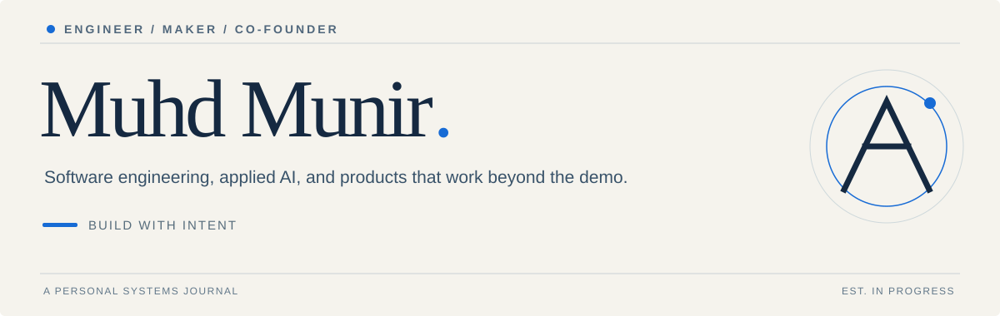
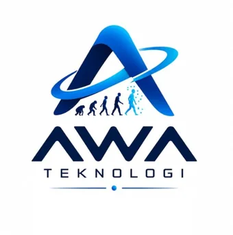

  

### A little about me

I’m **Muhd Munir**, a software and AI builder, and **Co-Founder at AWA Teknologi Indonesia**. My background is in automotive engineering; these days I spend more time building software, experimenting with applied AI, and connecting hardware to the web.

I like interfaces that make sense, systems that are easy to maintain, and products that do something useful outside a demo.

**What I'm exploring:** full-stack systems · AI-assisted workflows · real-time interfaces · ESP32 & telemetry · developer tools.

---

### AWA Teknologi Indonesia

Building practical technology through a mix of engineering, product decisions, and iteration. [Visit AWA ↗](https://awatech.my.id)

### Take a break. Play a game.

I made **SIGNAL / 60**: a tiny 60-second arcade game. Catch blue signals, avoid amber interference. Built for both **touch** and **keyboard**.

**[Play SIGNAL / 60 ↗](https://munir-signal-60-muhdmunir961-bytes-projects.vercel.app/)** &nbsp;·&nbsp; [View the source](docs/index.html)

GitHub READMEs cannot execute interactive JavaScript. The game opens in a dedicated page.

---

**Keep in touch:** [AWA Teknologi](https://awatech.my.id) · [GitHub](https://github.com/muhdmunir961-byte)

*Build with intent. Keep learning.*