<!--
  MUHD MUNIR — Engineering profile / edition 09.5
  Identity-led, self-hosted motion artwork, reduced-motion support.
  No fake stats, no third-party widgets, no public repository showcase.
-->

  <picture>
    <source media="(prefers-color-scheme: dark)" srcset="assets/hero-dark.svg" />
    
  </picture>
   
   
  <a href="https://awatech.my.id"><strong>AWA TECHNOLOGY ↗</strong></a>
  &nbsp;&nbsp; / &nbsp;&nbsp;
  <a href="#the-engineer"><strong>ABOUT ↘</strong></a>
  &nbsp;&nbsp; / &nbsp;&nbsp;
  <a href="#engineering-in-practice"><strong>EXPERTISE ↘</strong></a>
  &nbsp;&nbsp; / &nbsp;&nbsp;
  <a href="#connect"><strong>CONNECT ↘</strong></a>
   
   
  <picture>
    <source media="(prefers-color-scheme: dark)" srcset="assets/signal-dark.svg" />
    
  </picture>

 

## 01 / The engineer

I’m **Muhd Munir** — a **Software & AI Engineer** and **Co-Founder of AWA Teknologi Indonesia**.

I’m drawn to problems that sit between **people, products, and complex systems**. I build across web applications, applied AI, automation, cloud services, and connected devices — with an eye for how everything works *together*, not just how one feature looks in isolation.

My background in **automotive engineering** brings a useful perspective: engineering decisions have consequences in the real world. Interfaces should communicate clearly. Systems should recover predictably. And good technology should make difficult things easier to do.

> **A principle I build by:** Make sophisticated engineering feel simple to the person using it.

 

## 02 / Building with AWA

<picture>
  <source media="(prefers-color-scheme: dark)" srcset="assets/founder-dark.svg" />
  
</picture>

 

**Co-Founder — AWA Teknologi Indonesia**

For me, being a founder means thinking beyond the code: defining worthwhile problems, balancing constraints, choosing practical architectures, and turning early concepts into useful experiences.

The work I’m interested in spans **software platforms, AI-enabled workflows, automation, and product engineering**. I value technology that is thoughtfully designed, realistic to operate, and capable of evolving with the people who use it.

**Explore the company:** [awatech.my.id ↗](https://awatech.my.id)

 

## 03 / Engineering in practice

<picture>
  <source media="(prefers-color-scheme: dark)" srcset="assets/focus-dark.svg" />
  
</picture>

 

| Discipline | Where I focus |
| :--- | :--- |
| **Applied AI** | LLM integrations, practical agents, tool orchestration, automation and human-in-the-loop workflows |
| **Software systems** | Backend services, APIs, data flows, full-stack web platforms and thoughtful frontend experiences |
| **Cloud & infrastructure** | Deployment pipelines, service configuration, reliability, real-time connections and operational workflows |
| **Connected engineering** | ESP32-based systems, device telemetry, safety-oriented interfaces and monitoring dashboards |

I care as much about the **experience of using a system** as I do about its architecture. A good result needs both.

 

## 04 / Behind the terminal

<picture>
  <source media="(prefers-color-scheme: dark)" srcset="assets/terminal-dark.svg" />
  
</picture>

 

The best software doesn’t come from using the most tools. It comes from understanding the problem, making deliberate trade-offs, and iterating until the experience makes sense.

<picture>
  <source media="(prefers-color-scheme: dark)" srcset="assets/stack-dark.svg" />
  
</picture>

 

**Also working with:** JavaScript · Fastify · Prisma · Arduino / C++ · WebSockets · Git & GitHub · Cloud deployment tooling.

*I choose the stack to suit the constraints — not the other way around.*

 

## 05 / A systems mindset

<picture>
  <source media="(prefers-color-scheme: dark)" srcset="assets/network-dark.svg" />
  
</picture>

 

<table>
  <tr>
    <td width="33%" valign="top"><strong>Clarity first.</strong>  Understand the user, the context, and the real cost of a bad assumption.</td>
    <td width="33%" valign="top"><strong>Architecture with intent.</strong>  Prefer legible systems, measured complexity, and maintainable choices.</td>
    <td width="33%" valign="top"><strong>Delivery matters.</strong>  Test the edges, learn from feedback, and ship improvements that count.</td>
  </tr>
</table>

 

### What I’m exploring now

- **Agentic AI:** systems that use tools responsibly to assist with actual work.
- **Real-time experiences:** clear, responsive interfaces connected to live information.
- **Engineering platforms:** ways to simplify development, deployment, and operations.
- **Hardware meets software:** translating device signals into useful human feedback.

 

## 06 / Connect

I’m interested in conversations about **software architecture, applied AI, thoughtful products, automation, and building technology across disciplines**.

  <a href="https://awatech.my.id"><strong>AWA Teknologi Indonesia ↗</strong></a>
  &nbsp;&nbsp;&nbsp; · &nbsp;&nbsp;&nbsp;
  <a href="https://github.com/muhdmunir961-byte"><strong>GitHub ↗</strong></a>
   
   
  <picture>
    <source media="(prefers-color-scheme: dark)" srcset="assets/footer-dark.svg" />
    
  </picture>
   
  ENGINEERING WITH INTENT · ALWAYS LEARNING · ALWAYS BUILDING

<!-- README deliberately does not feature repository cards, rankings, or fabricated performance metrics. -->
